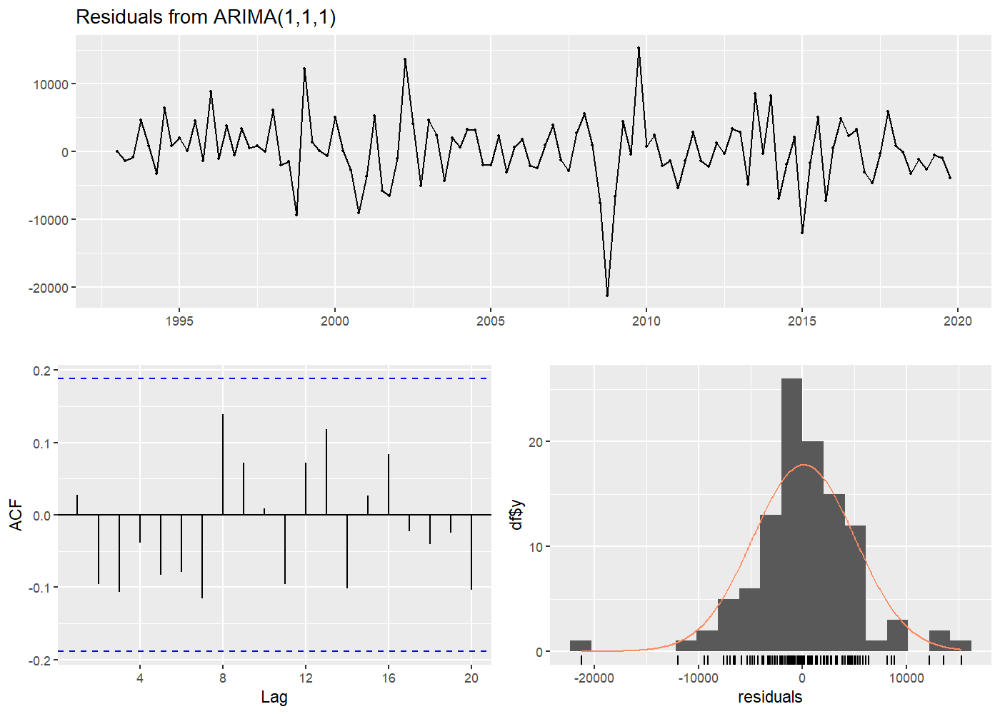
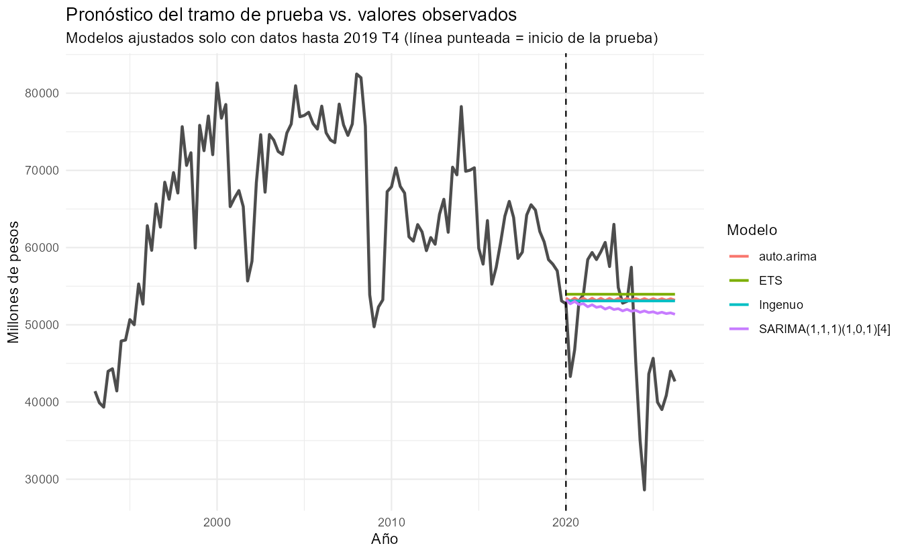
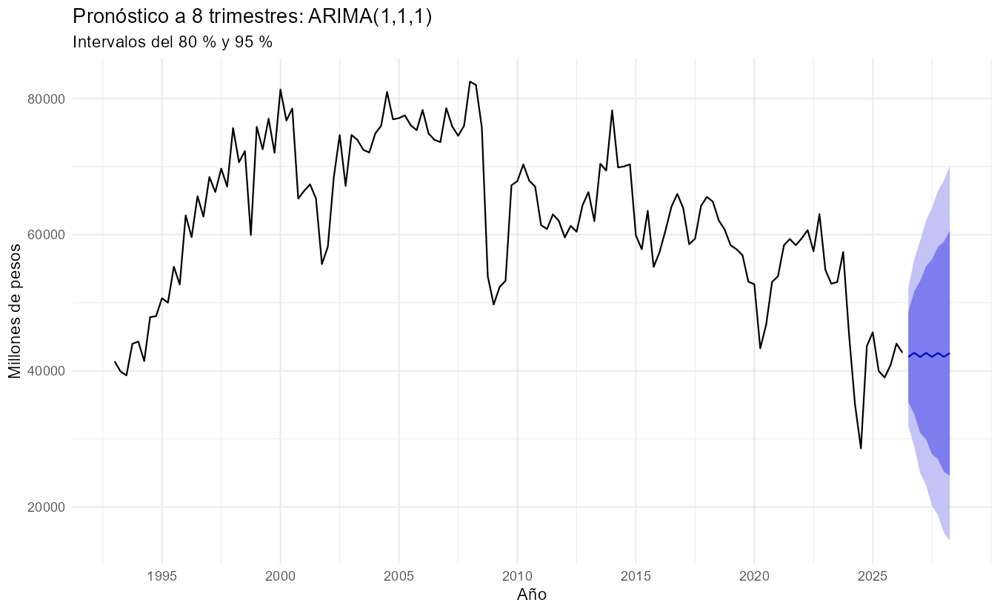

# Series de tiempo: precios de hierro y acero

¿Qué tan bien se puede pronosticar esta serie con modelos SARIMA y de suavizamiento exponencial (ETS)? Y, sobre todo, ¿superan a un modelo ingenuo que simplemente repite el último valor?

El proyecto sigue un flujo completo en R: exploración, pruebas de estacionariedad, identificación y comparación de modelos, evaluación con datos que el modelo no vio, diagnóstico de residuos y pronóstico.

## Datos

- **Serie:** precios de hierro y acero, en millones de pesos (`acero_precio_mdp.xlsx`).
- **Frecuencia y periodo:** trimestral, de 1993 T1 a 2026 T2 (134 observaciones).
- **Rango:** mínimo de 28,607 (2024 T3) y máximo de 82,481 (2008 T1).
- **Fuente:** INEGI, [Banco de Información Económica (BIE)](https://www.inegi.org.mx/app/indicadores/?tm=3#). Serie descargada como "Precios de hierro y acero (mdp)".
- **Nota:** el archivo viene ordenado del dato más reciente al más antiguo. El script lo ordena cronológicamente antes de crear el objeto `ts`; si no se hace, la serie queda invertida en el tiempo y todos los modelos se ajustan "al revés".

## Metodología

1. **Exploración:** gráfica de la serie, valor promedio por trimestre y descomposición STL.
2. **Estacionariedad:** pruebas ADF y KPSS, número de diferencias (`ndiffs`, `nsdiffs`) y gráficas ACF/PACF de la serie diferenciada.
3. **Entrenamiento y prueba:** modelos ajustados con datos hasta 2019 T4 (108 trimestres) y evaluados en 2020 T1 – 2026 T2 (26 trimestres).
4. **Modelos comparados:** ingenuo, ingenuo estacional, tres SARIMA candidatos (identificados con ACF/PACF), `auto.arima` y ETS.
5. **Evaluación fuera de muestra:**
   - Tramo de prueba: MAE, RMSE, MAPE y MASE.
   - Validación hacia adelante (`tsCV`, reajustando el modelo en cada origen): pronóstico a 1 y a 4 trimestres.
6. **Diagnóstico de residuos** del modelo con menor AICc: Ljung-Box, Shapiro-Wilk y gráfico Q-Q.
7. **Pronóstico final** a 8 trimestres, reajustando el modelo con toda la serie.

## Resultados

### Exploración y estacionariedad

- La serie sube hasta alrededor de 2008, cae de forma brusca y desciende en los años siguientes, con un mínimo en 2024 T3. No tiene una tendencia lineal.
- **La estacionalidad es muy débil:** su fuerza es de 0.06 (en una escala de 0 a 1) y el componente estacional oscila entre -694 y 930, frente a valores de entre 28,000 y 82,000. `nsdiffs` indica 0 diferencias estacionales.
- **No se aplicó transformación logarítmica:** no se observa varianza creciente (la desviación estándar fue menor después de 2008 que antes: 9,467 frente a 11,949).
- La serie original **no es estacionaria** (ADF p = 0.073; KPSS p = 0.01). Con **una diferencia** sí lo es (ADF p < 0.01; KPSS p > 0.10), en línea con `ndiffs` = 1.

### Selección del modelo

| Modelo | Orden | AIC | AICc | BIC |
|---|---|---|---|---|
| auto.arima | ARIMA(1,1,1) | 2129.7 | 2130.0 | 2137.8 |
| SARIMA | (1,1,1)(1,0,1)[4] | 2133.3 | 2133.9 | 2146.6 |
| SARIMA | (1,1,2)(1,0,1)[4] | 2135.1 | 2135.9 | 2151.1 |
| SARIMA | (2,1,1)(1,0,1)[4] | 2135.1 | 2136.0 | 2151.2 |

Los términos estacionales no mejoran el ajuste, de acuerdo con la estacionalidad débil. Se selecciona ARIMA(1,1,1).

### Diagnóstico de residuos (ARIMA(1,1,1))

- **Ljung-Box (8 rezagos):** p = 0.243. No hay evidencia de autocorrelación en los residuos.
- **Shapiro-Wilk:** p = 0.0004. Los residuos **no son normales**: tienen colas pesadas, con algunos errores muy grandes (por ejemplo, alrededor de 2011). Los intervalos de predicción deben leerse con cautela.



### Evaluación en el tramo de prueba (26 trimestres hacia adelante)

| Modelo | MAE | RMSE | MAPE (%) | MASE |
|---|---|---|---|---|
| SARIMA(1,1,2)(1,0,1)[4] | 7,323 | 8,835 | 16.9 | 1.10 |
| SARIMA(2,1,1)(1,0,1)[4] | 7,324 | 8,844 | 16.9 | 1.10 |
| SARIMA(1,1,1)(1,0,1)[4] | 7,332 | 8,899 | 17.0 | 1.10 |
| **Ingenuo** | **7,511** | **9,434** | **17.8** | **1.13** |
| auto.arima | 7,555 | 9,513 | 17.9 | 1.13 |
| ETS | 7,714 | 9,788 | 18.4 | 1.16 |
| Ingenuo estacional | 9,192 | 11,715 | 22.1 | 1.38 |



### Validación hacia adelante

| Modelo | MAE (1 trim.) | RMSE (1 trim.) | MAE (4 trim.) | RMSE (4 trim.) |
|---|---|---|---|---|
| **Ingenuo** | **3,881** | **5,561** | **7,720** | **10,410** |
| auto.arima | 4,273 | 6,082 | 8,330 | 11,635 |
| ETS | 4,534 | 6,112 | 7,723 | 10,485 |
| SARIMA(2,1,1)(1,0,1)[4] | 4,274 | 6,116 | 8,312 | 11,274 |
| SARIMA(1,1,1)(1,0,1)[4] | 4,287 | 6,120 | 8,479 | 11,741 |
| SARIMA(1,1,2)(1,0,1)[4] | 4,356 | 6,155 | 8,364 | 11,361 |

### Pronóstico a 8 trimestres



El pronóstico puntual es casi plano (alrededor de 42,000). El intervalo del 95 % se amplía hasta cerca de 15,000–70,000 al octavo trimestre.

## Conclusiones

- **Ningún modelo supera de forma consistente al modelo ingenuo.** En el tramo de prueba, los SARIMA mejoran solo ≈2 % en MAE, y en la validación hacia adelante (1 y 4 trimestres) el ingenuo es el mejor. La serie se comporta casi como una caminata aleatoria con cambios bruscos de nivel.
- La estacionalidad es prácticamente inexistente, así que los modelos estacionales no aportan.
- Un buen diagnóstico de residuos no implica un buen pronóstico: el modelo cumple los supuestos de no autocorrelación y aun así no mejora a la referencia.
- Este pronóstico sirve para **estimar un rango plausible**, no para predecir un valor puntual.

## Limitaciones

- La serie tiene cambios bruscos de nivel (por ejemplo, entre 2008 y 2009 y desde 2024) que ningún modelo univariado anticipa.
- Los residuos no son normales, por lo que los intervalos de predicción son aproximados.
- La prueba es un solo periodo largo (2020 T1 – 2026 T2) que incluye cambios fuertes; por eso se añade la validación hacia adelante.
- Es un modelo univariado: no incorpora variables externas que puedan explicar los cambios.

## Cómo reproducirlo

```r
# En R, con la carpeta del proyecto como directorio de trabajo
source("instalar_paquetes.R")                 # solo la primera vez
source("analisis_series_tiempo_acero.R")
```

El script genera las gráficas en `figuras/` y las tablas en `resultados/` (CSV y un Excel con las tres comparaciones).

## Estructura

```
series-de-tiempo-acero/
├── README.md
├── analisis_series_tiempo_acero.R
├── instalar_paquetes.R
├── acero_precio_mdp.xlsx
├── figuras/        (8 gráficas)
└── resultados/     (comparación de modelos y pronóstico)
```

## Autor

**Emmanuel de Jesús Sánchez Parra** — Data Scientist | Especialista en Métodos Estadísticos

- GitHub: [EmmanuelBjj](https://github.com/EmmanuelBjj)
- Portafolio: [Portafolio-Data-Science](https://github.com/EmmanuelBjj/Portafolio-Data-Science)
